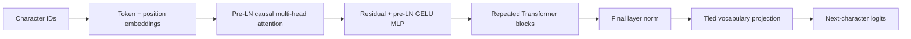

# MiniGPT

MiniGPT is a small, inspectable decoder-only Transformer language model implemented with PyTorch tensor operations, autograd, and AdamW. It is for learning the mechanics of next-token prediction, not a pretrained model or production assistant.

## Architecture



The deterministic character vocabulary is built from training text only. Unknown characters map to ID 0. Each training example shifts targets by one character. Causal attention masks future characters, uses scaled dot products, and combines multiple heads. See [architecture](docs/architecture.md), [training](docs/training.md), [evaluation](docs/evaluation.md), and [limitations](docs/limitations.md).

## Setup (Windows PowerShell)

```powershell
python -m venv .venv
.\.venv\Scripts\Activate.ps1
python -m pip install -r requirements.txt
python -m pytest -q
python scripts/run_smoke_test.py
```

The smoke test trains five CPU steps on the bundled educational fixture and writes local files to `artifacts/smoke/`. It is not a quality experiment.

## Data and training

The bundled `data/tiny_corpus.txt` is original educational text included for offline execution. For a larger reproducible experiment, download *Alice's Adventures in Wonderland*, Project Gutenberg eBook 11. Its catalog lists the work as public domain in the USA. Project Gutenberg advises readers elsewhere to check local law; India's Copyright Office describes the general life-plus-60-year term for published literary works. See [data provenance and terms](data/README.md). The download command requires internet access:

```bat
python scripts\prepare_data.py --alice --output data\corpus.txt
```

Alternatively, prepare a local UTF-8 text file:

```powershell
python scripts/prepare_data.py --input PATH_TO_TEXT_FILE --output data/corpus.txt
```

Train directly against the prepared corpus (the default config and offline smoke flow remain unchanged), then evaluate the resulting checkpoint:

```powershell
python scripts/train.py --config configs/default.json --data data/corpus.txt
python scripts/train.py --config configs/default.json --data data/corpus.txt --steps 10
python scripts/evaluate.py --checkpoint artifacts/minigpt.pt
python scripts/generate.py --checkpoint artifacts/minigpt.pt --prompt "Language models" --greedy
```

Generation truncates old context to the configured window, supports greedy decoding, temperature and top-k. Checkpoints and generated metrics are local and ignored by Git. Evaluation must be run on the unchanged corpus used during training to reproduce its split convention.

## Measured results

The bundled corpus is only a smoke fixture. The table includes the five-step functionality check, the user's original final-step run, and a rerun with the best-validation checkpoint selection now implemented. The selected model was chosen on validation loss at step 100 and evaluated on the held-out final split afterward. All results are fixture-specific and are not evidence of general language ability.

| Model | Train loss | Validation loss | Test loss | Perplexity | Parameters | Training time |
|---|---:|---:|---:|---:|---:|---:|
| MiniGPT (5-step smoke) | 3.5812 | 3.5131 | 3.5251 | 33.9564 | 15,104 | 0.053 s |
| MiniGPT (300 steps, best validation at step 100) | 2.2447* | 2.7452 | 2.5840 | 13.2500 | 106,816 | 19.65 s |
| MiniGPT (300 steps, previous final checkpoint) | 1.3839* | 3.5456 | 3.0402 | 20.9086 | 106,816 | 9.49 s |
| Add-one character bigram | N/A — not measured | N/A — not measured | 2.8374 | 17.0717 | N/A — not recorded | N/A — not recorded |

*Training loss is the final minibatch at the selected step, not an average over the entire training split. The previous final-step model overfit substantially. Best-validation selection improved the measured test loss and beat the baseline on this tiny fixture, which is not sufficient evidence of broad language-model quality. The selected model generated `Languagentin te te te tin ten te tion ton t an t te te t te te ten t`, still poor text. The five-step smoke generation was `Languageennnnnnnnnnn`. No corpus-scale experiment has been run. Current training writes a loss CSV and, when there are at least three evaluation points, a plot.

## Resource expectations

The default configuration is a 2-layer, 64-dimensional model with context length 64 and batch size 16. It runs on CPU; CUDA is optional but not configured by default. Dependencies are PyTorch, pytest, and matplotlib. PyTorch checkpoints should only be loaded from trusted sources.

## Repository layout

`minigpt/` contains the tokenizer, dataset, attention, Transformer, model, training, evaluation and checkpoint code. `scripts/` contains command-line entry points, `tests/` contains the automated suite, and `docs/` contains implementation notes. The license is MIT. The bundled fixture is original and has no external dataset attribution.

Interview questions and concise explanations are in [docs/interview_prep.md](docs/interview_prep.md).

## License and attribution

Code is released under the MIT License. The educational fixture was written for this project. External corpora are not bundled; users are responsible for documenting and complying with their selected dataset license.
